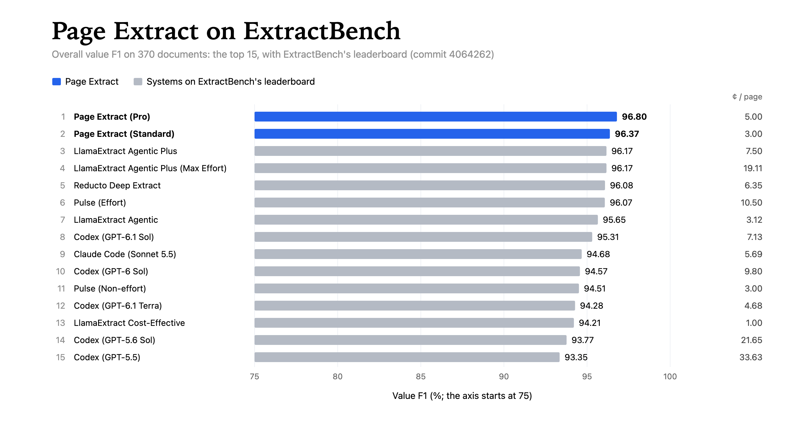
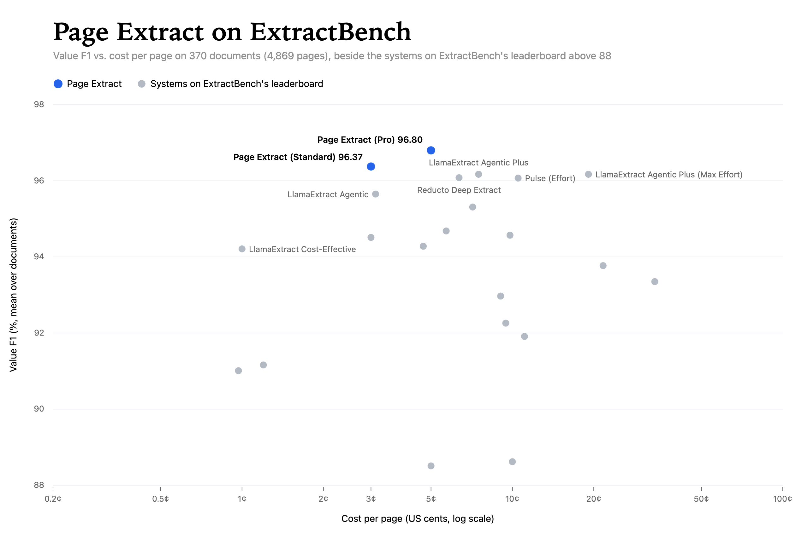

# Page Extract benchmarks

Page Extract's results on extraction benchmarks, with every document's result and score, and scripts that run each
benchmark again through Page Extract's API. Each folder is one benchmark and stands on its own.

## ExtractBench

370 documents (4,869 pages), scored with ExtractBench's own scorer: 96.80 value F1 at the Pro tier (5¢ a page) and
96.37 at Standard (3¢ a page), both above every system on ExtractBench's leaderboard.

[Results, how they were made, and how to run them again through the API →](extractbench/README.md)
